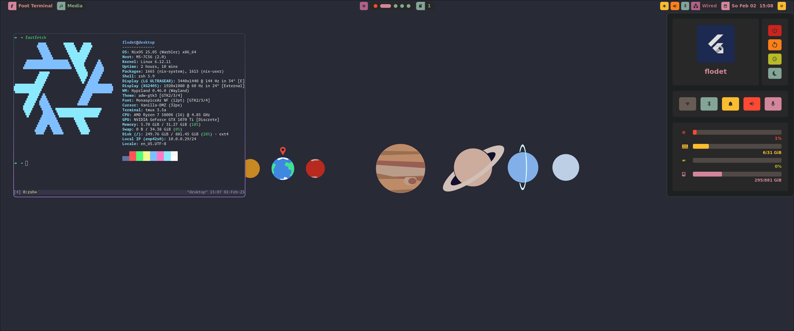

# My Nix configurations

NixOS and home-manager configuration for my machines, as a flake.



## Structure

```
.
├── flake.nix      | Entry point: hosts, packages, dev shell, checks
├── hosts/         | NixOS config per machine (+ _shared modules and components)
├── home/          | home-manager config per user and machine (+ _shared)
├── installer/     | Offline installer ISO (not a host)
├── scripts/       | Workflow scripts (dev shell / `nix run .#<name>`)
├── keys/          | Public keys only: admins, per-host sops keys, GPG/SSH
├── security/      | CVE scan whitelist
├── overlays/      | pkgs.stable, pkgs.inputs.*, patches
├── pkgs/          | Custom packages
└── docs/          | How-tos (see below)
```

## Usage

```sh
nix develop                               # tooling (or `nix-shell` on a fresh install)
sudo nixos-rebuild switch --flake .#<host>  # applies system and home-manager
```

## Docs

| Topic | |
| --- | --- |
| Installing a machine (USB stick) | [docs/installer.md](docs/installer.md) |
| Wiped root, what persists | [docs/impermanence.md](docs/impermanence.md) |
| Secrets (sops) | [docs/secrets.md](docs/secrets.md) |
| YubiKey | [docs/yubikey.md](docs/yubikey.md) |
| Cloud servers | [docs/cloud.md](docs/cloud.md) |
| Security updates, CVEs | [docs/security-updates.md](docs/security-updates.md) |
| Claude Code | [docs/claude-code.md](docs/claude-code.md) |
| Privacy, telemetry | [docs/privacy.md](docs/privacy.md) |
